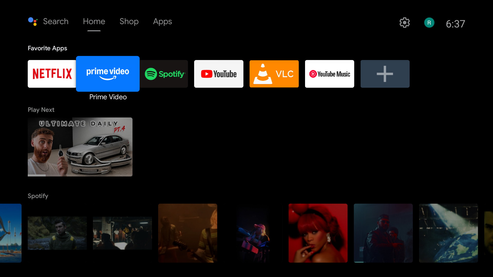
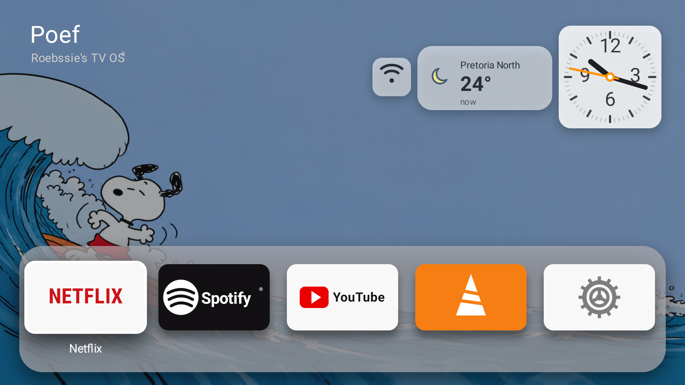
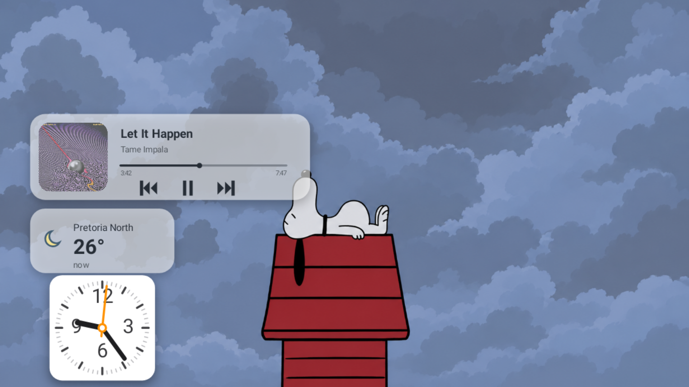
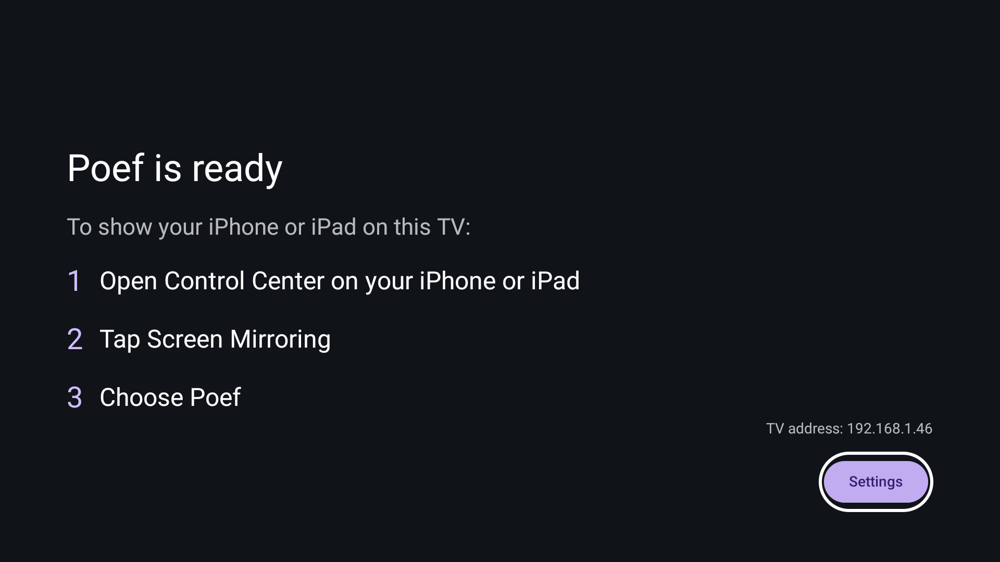

# Debloat Mi Box S — Roebssie’s TV OS

A resource-conscious Android TV launcher and debloat project for a Xiaomi Mi Box S. The goal is a calm, minimal home screen instead of the recommendation-heavy Android TV / Google TV experience.

## Hardware target

This was built for my Xiaomi Mi Box S 4K, described here as the circa-2019 box in my setup. Xiaomi also has a separately named **TV Box S (2nd Gen)**, so the exact model should be confirmed from the box’s **Settings → About** page before reproducing the setup on another device.

- [Original Xiaomi Mi Box S specifications](https://www.mi.com/global/product/mi-box-s/specs/)
- [Xiaomi TV Box S (2nd Gen)](https://www.mi.com/global/product/xiaomi-tv-box-s-2nd-gen/)

## Before and after

### Stock Android TV-style home screen

### Roebssie’s TV OS home screen

The custom launcher focuses on Netflix, Spotify, YouTube, VLC, and Settings. It adds a Snoopy surf wallpaper, Pretoria North weather, a live analog clock, a glass Wi-Fi tile, and a five-minute custom screensaver.

### Custom screensaver

The five-minute idle view keeps the box useful without returning to the stock recommendation feed.

## What changed

- Minimal five-app dock with Apple TV-inspired spacing, glass surfaces, shadows, and focus animation.
- Custom Snoopy wallpaper with ocean edge fill and no bottom strip.
- Live analog clock with a second hand.
- Pretoria North weather with condition-aware icons.
- Square glass Wi-Fi tile; dark when idle and white when focused.
- AirPlay service kept in the background; visible Sideplay/AirPlay menus return to Poef Home.
- Integrated and configured AirPlay receiver service with a Poef-side guard that keeps audio quiet while allowing a real video mirror surface to render.
- Audio-only AirPlay uses a compact banner containing only a dark AirPlay mark and `AirPlay audio`.
- Five-minute custom screensaver with clock, weather, AirPlay mark, and optional media banner.
- Boot receiver opens Poef Home only; it does not open Wi-Fi settings or Sideplay’s visible activity.

## The story

I started with a Xiaomi Mi Box S whose stock Android TV home screen was crowded with recommendations, movie rows and services I did not use. I wanted the box to feel intentional: a small set of apps, a calm wallpaper, readable information and a remote-friendly interface that gets out of the way.

I built the Poef launcher around that idea, then kept refining it on the real device. The result is a lightweight personal TV OS with an Apple TV-inspired layout, a Snoopy surf scene, Pretoria North weather, a live clock, quiet AirPlay support and media-aware banners for Spotify. The project also documents the compromises: the box still boots through Xiaomi and Android’s protected startup stages, and its panel remains a 1080p device even when the artwork is rendered sharply.

### AirPlay story

I created a custom AirPlay service app that runs on the Mi Box. It stays in the background, keeps the receiver available, and is designed for smooth, high-quality audio and video without letting the receiver screen take over the launcher.

## Skills demonstrated

This project records the practical skills I used while building and validating the box:

| Area | What I practised |
| :--- | :--- |
| Android TV development | Java launcher work, Android activities, boot receivers, dream/screen-saver services, focus navigation and remote-key handling |
| ADB over Wi‑Fi | Connecting to the box, inspecting activities and services, capturing screenshots, installing builds and running repeatable device checks |
| Android services | Keeping AirPlay available in the background while preventing its visible activity from taking over the home screen |
| AirPlay integration | Configured the receiver service, implemented the Poef-side menu guard, preserved the working audio path, and validated a live 1080p Mac mirror surface |
| Accessibility APIs | A tightly scoped window guard that returns Home only when the AirPlay receiver’s visible page appears |
| Media integration | Notification listeners, MediaSession metadata, Spotify artwork, track details, progress and playback controls |
| UI rendering | Anti-aliased Canvas/vector-style graphics, glass surfaces, focus states, weather icons, analog clock hands and smooth scrolling text |
| APK build and debugging | Android resource packaging, uncompressed audio resources, signing, clean reinstall recovery and log-driven troubleshooting |
| Documentation and release work | Before/after screenshots, comparison notes, safe ADB workflow documentation, Git and GitHub project publishing |

## Android TV / Google TV context

Google documents that Android TV and Google TV homes can show movies, shows, app rows, sponsored content, and personalized recommendations. Google’s Apps-only mode hides personalized recommendations but can still retain sponsored content and teasers. This project replaces the home surface with a focused local launcher.

- [Google TV and Android TV overview](https://support.google.com/googletv/answer/10267283)
- [Google TV recommendations and Apps-only mode](https://support.google.com/googletv/answer/10466129)
- [Android TV Apps-only mode](https://support.google.com/androidtv/answer/10267283)

## Repository contents

- `app/` — Poef launcher source, manifest, resources, wallpaper, and sounds.
- `screenshots/` — before/after visual comparison captured from the device.
- `docs/adb-workflow.md` — safe wireless ADB workflow and verification checklist.
- `docs/airplay-guard.md` — receiver integration, audio handling, and mirror-surface guard notes.

## Safety notes

This repository intentionally excludes device IP addresses, private signing keys, passwords, APK output files, account data, and cloud credentials. The AirPlay receiver remains a separate dependency; this launcher keeps it out of the foreground and renders its state.

The launcher targets the Mi Box’s native 1080p output. It uses anti-aliased canvas/vector-style drawing for clean rendering at that resolution; it does not turn 1080p hardware into 4K or 8K hardware.
